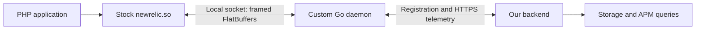

# New Relic PHP source investigation

Examined on 25 October 2026 (Asia/Bangkok).

## Result

Both the PHP extension and daemon source are public in [newrelic/newrelic-php-agent](https://github.com/newrelic/newrelic-php-agent). They are included in the downloaded checkout; there is no need to reverse-engineer an unavailable daemon binary.

The checkout is pinned to **v12.12.0.41**, commit `cf77822cd783c43cf3f8bb2acc1caa22c49e23cb`. This was the latest release returned by GitHub's releases API during the investigation. The repository's `VERSION` file contains `12.12.0`; the release tag includes the build suffix `.41`. The initial `main` checkout and this release tag resolved to the same commit.

Source inspection supports keeping the stock PHP module and adapting the Go daemon. Runtime compatibility still needs to be demonstrated with the exact stock module version we intend to deploy.

## Source layout

All paths below are relative to `upstream/newrelic-php-agent/`.

| Location | Role and useful entry points |
| --- | --- |
| `agent/` | C PHP extension, Zend hooks, framework/library instrumentation and PHP API. `php_nrini.c` registers settings; `php_txn.c` prepares application information and transaction options. |
| `axiom/` | PHP-independent C core: transactions, segments, metrics, sampling, traces, SQL and daemon communication. |
| `axiom/nr_agent.c` | Local socket connection and reconnect logic. |
| `axiom/cmd_appinfo_transmit.c` | Builds application registration requests; parses daemon replies and collection settings. |
| `axiom/cmd_txndata_transmit.c` | Serializes transaction data and sends it to the daemon. |
| `axiom/cmd_span_batch_transmit.c` | Additional span batch transport. |
| `protocol/flatbuffers/protocol.fbs` | Authoritative schema for the extension-to-daemon messages. |
| `daemon/cmd/daemon/` | Go executable, configuration, worker/watchdog processes and listener startup. |
| `daemon/internal/newrelic/listener.go` | Local message framing and socket reads/writes. |
| `daemon/internal/newrelic/commands.go` | FlatBuffers decoding, application replies and telemetry dispatch/aggregation. |
| `daemon/internal/newrelic/processor.go` | Application registration, state machine, harvest scheduling and export. |
| `daemon/internal/newrelic/app.go` | Application identity, collector connect request/reply structures. |
| `daemon/internal/newrelic/collector/` | HTTPS collector protocol, compression, certificates and HTTP response handling. |
| `daemon/internal/newrelic/*_events.go`, `metrics.go`, `txn_traces.go`, `slow_sqls.go` | Sampling, aggregation and collector payload serialization. |
| `daemon/internal/newrelic/infinite_tracing/` | Separate gRPC trace-observer export path. |
| `daemon/internal/flatbuffersdata/`, `axiom/tests/test_cmd_*.c`, daemon `*_test.go` | Existing message examples and protocol/behavior tests. |

## Data flow



The upstream daemon performs application registration, metric aggregation, event reservoir sampling, trace/slow-SQL selection, periodic harvests and limited failed-harvest rollover. Its local protocol is different from its outbound collector protocol. Neither is OTLP.

The daemon only receives what the module has retained after its own instrumentation, configuration, thresholds and sampling. Replacing the daemon cannot recover data already omitted by the module.

## Extension-to-daemon protocol

Transport can be a Unix domain socket, Linux abstract Unix socket, or TCP. Linux defaults to `@newrelic`; the other-platform default in the source is `/tmp/.newrelic.sock`. For the requested client-local daemon, use a local socket or loopback TCP.

`listener.go` defines an eight-byte header:

| Bytes | Encoding | Meaning |
| --- | --- | --- |
| 0-3 | Little-endian uint32 | Body length, excluding the header |
| 4-7 | Little-endian uint32 | Message encoding; `2` is binary FlatBuffers |
| 8 onward | FlatBuffers | `protocol.Message` body |

The current listener caps the body at `2 << 20` bytes (2 MiB). Although the encoding enum names raw and JSON types, `CommandsHandler.HandleMessage` accepts only the binary type.

The message has an `agent_run_id` and a union body:

- `App`: application name, license string, module version/language, host, environment/settings/labels, collection limits and optional trace observer/security policy configuration.
- `AppReply`: status, collector connect JSON, security policies, connect timestamp, harvest frequency and sampling target.
- `Transaction`: transaction name/URI, metric summaries, optional sampled transaction event, errors, slow SQL, custom events, trace, span events, logs and package metadata.
- `SpanBatch`: encoded span bytes and count, used by the trace observer path.

Registration has a request/reply exchange. Transaction and span-batch submissions do not receive per-message acknowledgements in the existing handler. Unknown run IDs are discarded by the processor. A custom daemon must preserve registration, run ID lifetime, reconnect behavior and message framing; decoding transaction messages alone is insufficient.

`cmd_appinfo_transmit.c` sets the application-info timeout to 100 ms. The daemon must keep this reply path quick; registration with a remote backend should happen asynchronously as it does upstream. Transaction sending has a separate 500 ms deadline and can affect worker availability.

## Registration and collection controls

Upstream registration proceeds as follows:

1. The extension sends an `App` message to the daemon.
2. `ConnectApplication` sends `preconnect` to the selected collector. The reply supplies `redirect_host` and optional security policies.
3. The daemon sends `connect` to that host with application and environment details.
4. The response supplies `agent_run_id` and collection/sampling settings. The daemon parses these and returns the raw connect JSON inside a FlatBuffers `AppReply` to the module.
5. The module uses that run ID for telemetry; subsequent application checks can return `StillValid`.

Important source-level requirements for a replacement registration service:

- A string `agent_run_id` is required by the daemon's `parseConnectReply` and read as a string by the C module.
- In `axiom/nr_txn.c`, missing `collect_traces` or `collect_errors` defaults to false. A superficially successful minimal handshake can therefore silently disable traces, slow SQL and traced errors.
- Other collection flags include `collect_analytics_events`, `collect_span_events`, `collect_custom_events` and `collect_error_events`; flags can disable locally enabled features.
- Event limits and report periods are negotiated through `event_harvest_config` and `span_event_harvest_config`. Decide these explicitly for the features we support.
- Distributed tracing reads `trusted_account_key`, `account_id` and `primary_application_id` as strings. Our backend must define consistent identities and verify propagation across services if this feature is enabled.
- `entity_guid` is also read by the extension, and registration can supply URL and transaction naming rules.
- Security-policy negotiation is conditional on a configured security-policy token; it adds further handshake semantics.

The PHP INI license setter in `agent/php_nrini.c` checks length against `NR_LICENSE_SIZE`, which is **40** in `axiom/nr_app.h`. This setter does not perform remote verification. Using our own 40-character tenant token appears possible, but that is an implementation hypothesis until exercised with the stock module. A token must be validated by our daemon/backend; accepting a correctly sized string is not authentication.

## Existing collector wire format

If we reuse the existing collector client, the backend must accept HTTPS POST requests to:

```text
/agent_listener/invoke_raw_method
  ?marshal_format=json
  &protocol_version=17
  &method=<command>
  &license_key=<token>
  [&run_id=<run-id>]
```

The request body is JSON compressed with **zlib**, declared as `Content-Encoding: deflate` and `Content-Type: application/octet-stream`. Some fields inside trace and SQL payloads are additionally zlib-compressed and base64 encoded; decompressing the outer HTTP body does not fully decode those fields.

HTTP 200 responses are parsed as an envelope containing `return_value`, or an `exception` object. For a normal successful harvest, `{"return_value":null}` fits this envelope. Registration requires actual reply objects. The HTTPS scheme is hardcoded in `RpmCmd.url`; supply a hostname (optionally with port), not a full URL.

| Collector method | Payload category |
| --- | --- |
| `preconnect`, `connect` | Registration and collection policy |
| `metric_data` | Aggregated metric summaries |
| `analytic_event_data` | Sampled transaction events |
| `error_data`, `error_event_data` | Traced errors and error events |
| `transaction_sample_data` | Selected transaction traces |
| `sql_trace_data` | Slow SQL summaries and parameters |
| `custom_event_data` | Custom events |
| `span_event_data` | Span events |
| `log_event_data` | Application logs |
| `update_loaded_modules` | PHP package/module inventory |

For example, `MetricTable.CollectorJSON` emits `[run_id, start_epoch_seconds, end_epoch_seconds, metrics]`. Each metric pairs a name/optional scope object with six numeric summary values. Preserve metric-specific meanings: the same slots are used for duration summaries and Apdex counts.

The source contains a `newrelic.daemon.collector_host` INI override. `php_txn.c` copies it into `App.redirect_collector`, and `CalculatePreconnectHost` honors the override before license-based region routing. This makes a prototype with an unmodified daemon and a compatible collector endpoint plausible. It still needs the correct handshake, TLS trust and payload support; this setting alone does not create a compatible backend. Its presence in this source version is not a guarantee of long-term public configuration support.

TLS certificate validation remains enabled. `ClientConfig` supports CA file/path settings. An HTTP proxy setting tunnels/routes traffic and does not replace collector protocol semantics.

## Implementation options

| Approach | Work required | Assessment |
| --- | --- | --- |
| Adapt upstream Go daemon and retain collector protocol initially | Add controlled endpoint configuration/defaults; implement our backend's registration and selected collector methods. Preserve local protocol and aggregation. | Recommended starting point for the requested custom daemon; minimizes simultaneous changes. |
| Adapt upstream daemon and introduce our own backend protocol | Preserve the PHP-facing layer; replace registration/export and map our backend policy into the existing app reply. | Good longer-term option when we need a simpler ingestion API. More initial work in lifecycle and export code. |
| Write a new compatible daemon | Implement framing, FlatBuffers, registration replies, state, aggregation, sampling, export and failure handling. | Feasible but duplicates substantial existing functionality. |
| Keep stock daemon, emulate collector | Use the source-discovered host override and implement the collector protocol. | Useful baseline experiment; may remove the need for a custom daemon if its behavior proves sufficient. |

For a daemon fork, the useful seams are `ProcessorConfig.Client`, `collector.Client.Execute`, `ConnectApplication`, and `harvestPayload`. The collector interface permits swapping the backend adapter while retaining most processing. The Go packages are under `internal/`, so a separate external module cannot simply import them; keep the fork within the module tree or deliberately reorganize the packages.

## First interoperability milestone

This is proposed follow-up work, not implemented in this investigation:

1. Pin the production stock PHP module to the reviewed release, or repeat the protocol check for the actual installed version.
2. Build the daemon in a Linux development environment using the toolchain required by `daemon/go.mod`.
3. Start an isolated backend fixture supporting `preconnect`, `connect`, `metric_data`, `analytic_event_data` and `error_data`; return explicit collection policy and stable run IDs. Account for any additional methods enabled by that policy.
4. Run the stock module against the daemon and generate known PHP requests, an error and a slow query. Verify the selected streams against those known inputs; then extend to traces/spans/logs as supported.
5. Exercise daemon restarts, backend outages, re-registration, invalid tenant tokens, event limits and multiple apps/tenants. Confirm traffic reaches only intended endpoints.

Example module settings for that future fixture (not an installed configuration):

```ini
extension = newrelic.so
newrelic.appname = "custom-apm-fixture"
newrelic.license = "0123456789abcdef0123456789abcdef01234567"
newrelic.daemon.address = "127.0.0.1:31339"
newrelic.daemon.dont_launch = 3
newrelic.browser_monitoring.auto_instrument = false
```

The sample license is a 40-character test string, not a credential. The daemon must listen on the matching address and be started separately. A stock-daemon collector experiment additionally needs `newrelic.daemon.collector_host` pointing to the fixture and suitable TLS trust. Leave infinite tracing unconfigured for this milestone; its gRPC observer is a separate export destination. Browser monitoring should remain disabled until we explicitly support it.

Operational behavior also needs a deliberate decision: the upstream failed-harvest logic only carries some data forward in memory. `408`, `429`, `500` and `503` trigger rollover handling, but traced errors and transaction traces have no-op `FailedHarvest` handlers. This is not durable delivery. A backend that requires reliable retention needs a designed queue/spool and matching acknowledgement/deduplication semantics.

## Download and verification status

- Downloaded a shallow Git checkout with both components, schema files, tests, license and third-party notices.
- Verified release tag and checkout resolve to the recorded commit; `git fsck --connectivity-only` passed and the upstream working tree is clean.
- Examined source paths for local transport, registration, collection controls, aggregation/export, compression, TLS and failure behavior.
- No custom binaries were built, no PHP application was instrumented, and no telemetry was sent to New Relic or a custom collector during this investigation.
- Local Go is `go1.17.1 windows/amd64`; the reviewed module declares `go 1.26.0` and `toolchain go1.27.3`. The current toolchain is insufficient. Docker's server information query did not provide a usable engine response. The upstream development guide targets Linux builds, so a suitable Linux build/runtime environment remains to be selected.

The upstream repository contains an Apache-2.0 `LICENSE` and a `THIRD_PARTY_NOTICES.md`; both were retained with the source. Review these files when packaging a modified distribution.

Primary references: the [pinned source tree](https://github.com/newrelic/newrelic-php-agent/tree/cf77822cd783c43cf3f8bb2acc1caa22c49e23cb), its [protocol schema](https://github.com/newrelic/newrelic-php-agent/blob/cf77822cd783c43cf3f8bb2acc1caa22c49e23cb/protocol/flatbuffers/protocol.fbs), [development guide](https://github.com/newrelic/newrelic-php-agent/blob/cf77822cd783c43cf3f8bb2acc1caa22c49e23cb/docs/development.md), and [release page](https://github.com/newrelic/newrelic-php-agent/releases/tag/v12.12.0.41). Detailed conclusions above are based on the downloaded source at the recorded commit.
